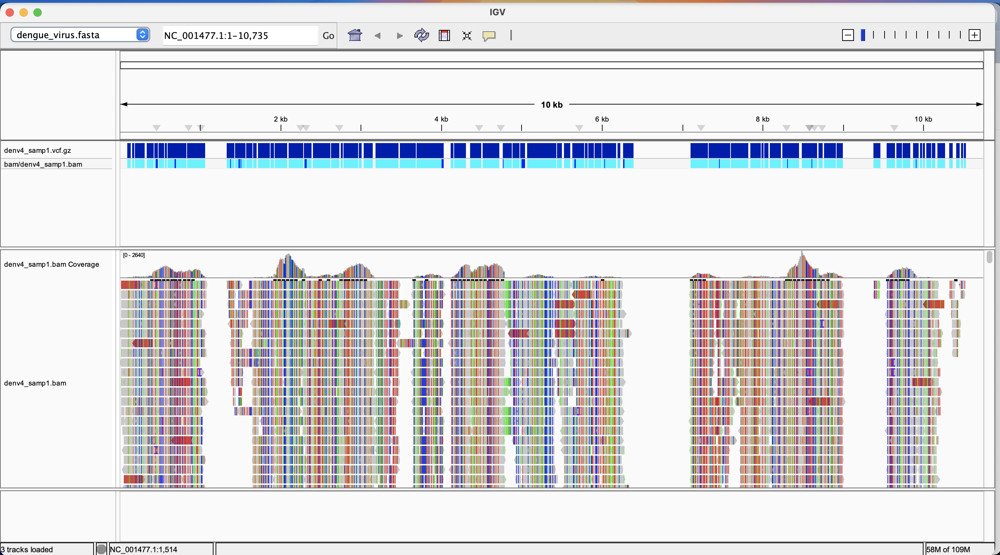
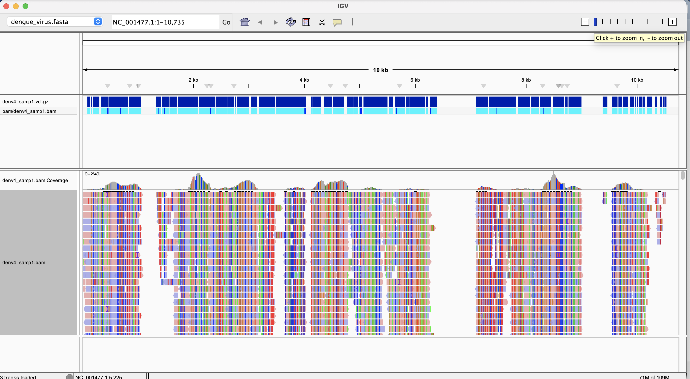
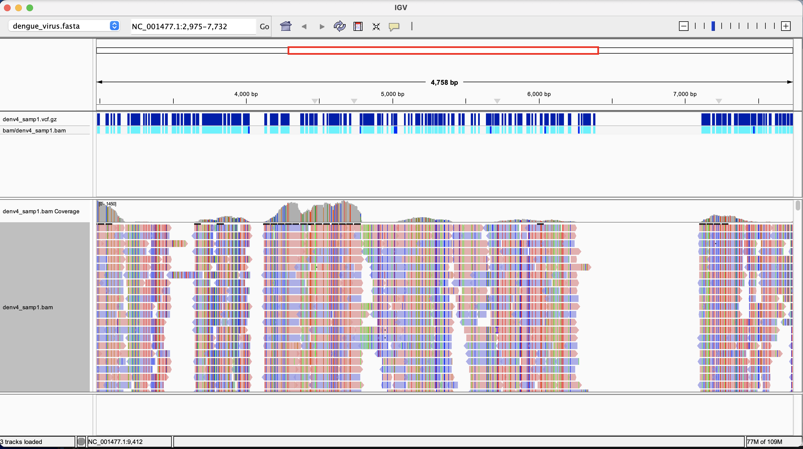
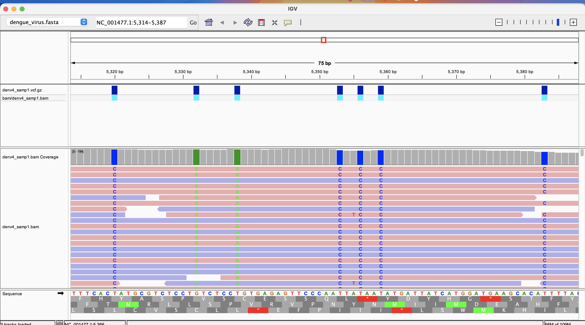
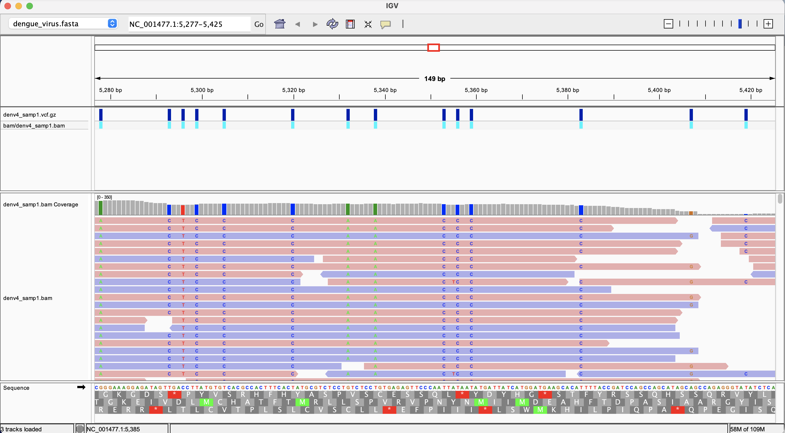
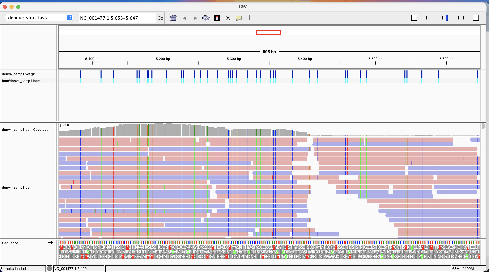
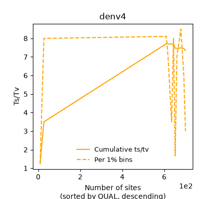
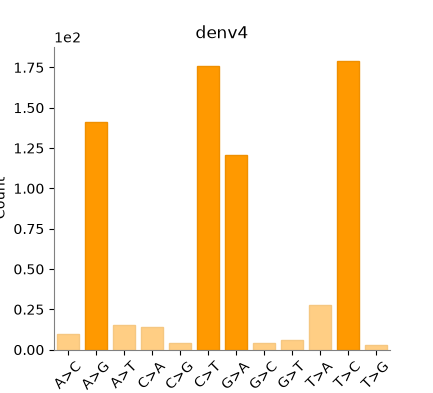
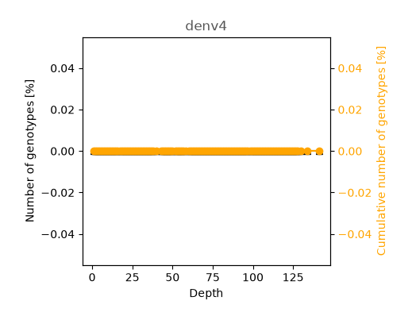
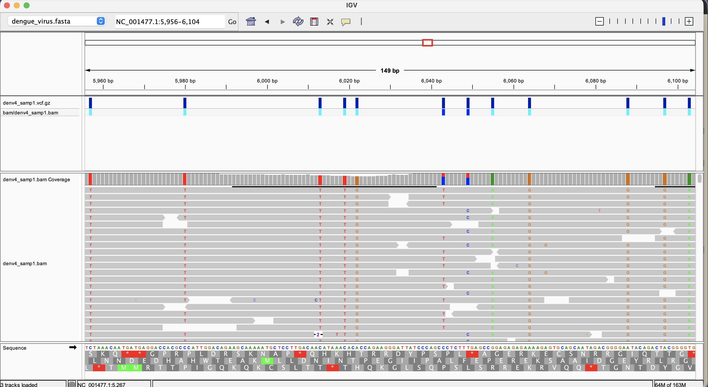

# Generate a VCF file

In week 5,we aligned reads to the dengue virus type 1 genome and created a BAM file.

Here, we call variants from that alignment and create a VCF file. 


## Calling variants from the BAM file
Run the Makefile that calls variants and creates a VCF file by running the following in the teminal after activating ```bioinfo```:

```
make all
```


## Visualize the VCF file in IGV.
 Below are different views of the vcf file in igv













## Run a statistics report on the VCF file.

Run the following to view statistics on the variant calling process:

```
bcftools stats vcf/denv4_samp1.vcf.gz
```

To look at some of these statistics graphically, run the following:

```
bcftools stats vcf/denv4_samp1.vcf.gz > stats.txt
plot-vcfstats stats.txt vcf/
```
This generates the following graphs:








**Below are some details from the statistics report**
 
- Number of variants called (records): **701**

- Kinds of variants present: All **701** variants are **SNPs**

### **We can use bftools to look at some mutations in the vcf file**

```
bcftools view -H vcf/denv4_samp1.vcf.gz | head
```

```
NC_001477.1    112    .    A    G    225.417    .    DP=73;AD=0,40;VDB=0.00085665;SGB=-0.693145;MQSBZ=0;MQ0F=0;AC=2;AN=2;DP4=0,0,23,17;MQ=60    
NC_001477.1    123    .    G    A    225.417    .    DP=78;AD=0,43;VDB=0.00226497;SGB=-0.693146;MQSBZ=-1.1239;MQ0F=0;AC=2;AN=2;DP4=0,0,24,19;MQ=59    
NC_001477.1    171    .    T    G    225.417    .    DP=102;AD=0,61;VDB=0.137198;SGB=-0.693147;MQSBZ=-1.89856;MQ0F=0;AC=2;AN=2;DP4=0,0,39,22;MQ=59   
NC_001477.1    208    .    T    C    225.417    .    DP=102;AD=0,64;VDB=0.858919;SGB=-0.693147;MQSBZ=-1.59861;MQ0F=0;AC=2;AN=2;DP4=0,0,46,18;MQ=59    
NC_001477.1    230    .    T    A    225.417    .    DP=93;AD=0,60;VDB=0.916113;SGB=-0.693147;MQSBZ=0;MQ0F=0;AC=2;AN=2;DP4=0,0,43,17;MQ=60   
NC_001477.1    244    .    T    C    225.417    .    DP=101;AD=0,63;VDB=0.992114;SGB=-0.693147;MQSBZ=0;MQ0F=0;AC=2;AN=2;DP4=0,0,42,21;MQ=60    
NC_001477.1    274    .    T    C    225.417    .    DP=103;AD=0,67;VDB=0.720803;SGB=-0.693147;MQSBZ=0;MQ0F=0;AC=2;AN=2;DP4=0,0,43,24;MQ=60    
NC_001477.1    302    .    G    A    225.417    .    DP=101;AD=0,68;VDB=0.212514;SGB=-0.693147;MQSBZ=0;MQ0F=0;AC=2;AN=2;DP4=0,0,40,28;MQ=60    
NC_001477.1    349    .    G    A    225.417    .    DP=97;AD=0,68;VDB=0.00457268;SGB=-0.693147;MQSBZ=0;MQ0F=0;AC=2;AN=2;DP4=0,0,42,26;MQ=60    
NC_001477.1    355    .    A    G    225.417    .    DP=96;AD=0,67;VDB=0.00202655;SGB=-0.693147;MQSBZ=0;MQ0F=0;AC=2;AN=2;DP4=0,0,42,25;MQ=60   
```

**Some interesting observations:**

Both the variant at position 112 and 355 have a reference base = A and alternative base = G. All variants shown have 225.417 reads covering the site. 

### **The calls like true variants (not errors).**


## Compare to alignments viewed in IGV

The alignments indicate substitutions which support the calls as seen in the pileup. Example below:


