# Interpreting a multisample VCF file
This task aims to generate a multisample VCF file based on the genome selected. Using at least three samples, annotate a few of the variants to try to tell what effect the change has on the protein.

To do this, start with the previous Makefile and add the annotation steps.


Run the Makefile iteratively in terminal. 

```
make align SRR=SRR35818875 SAMPLE_NAME=denv4_samp1
make align SRR=SRR35818873 SAMPLE_NAME=denv4_samp2
make align SRR=SRR35818859 SAMPLE_NAME=denv4_samp3
make align SRR=SRR35818860 SAMPLE_NAME=denv4_samp4
make align SRR=SRR35818861 SAMPLE_NAME=denv4_samp5
make align SRR=SRR35818866 SAMPLE_NAME=denv4_samp6
make align SRR=SRR35818878 SAMPLE_NAME=denv4_samp7
make align SRR=SRR35818863 SAMPLE_NAME=denv4_samp8
```


Pass all bam files into mpileup at once

```
bcftools mpileup -d 100 --annotate 'INFO/AD,FORMAT/DP,FORMAT/AD,FORMAT/ADF,FORMAT/ADR,FORMAT/SP' -O u -f fasta/dengue_virus.fasta \
    bam/denv4_samp1.bam \
    bam/denv4_samp2.bam \
    bam/denv4_samp3.bam \
    bam/denv4_samp4.bam \
    bam/denv4_samp5.bam \
    bam/denv4_samp6.bam \
    bam/denv4_samp7.bam \
    bam/denv4_samp8.bam | \
    bcftools call --ploidy 1 --annotate 'FORMAT/GQ' -mv -O u | \
    bcftools norm -f fasta/dengue_virus.fasta -d all -O u | \
    bcftools sort --write-index -O z -o vcf/dengue_multisample.vcf.gz
```

## Annotate a few variants
Select a few variants that fall in a coding sequence. If the VCF has none, choose a different sample.
Predict the effect of each variant either by eye or with a software tool.

### Initial view

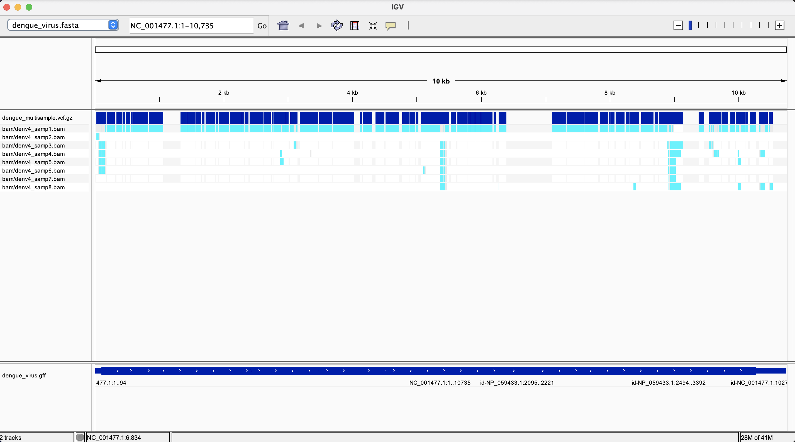

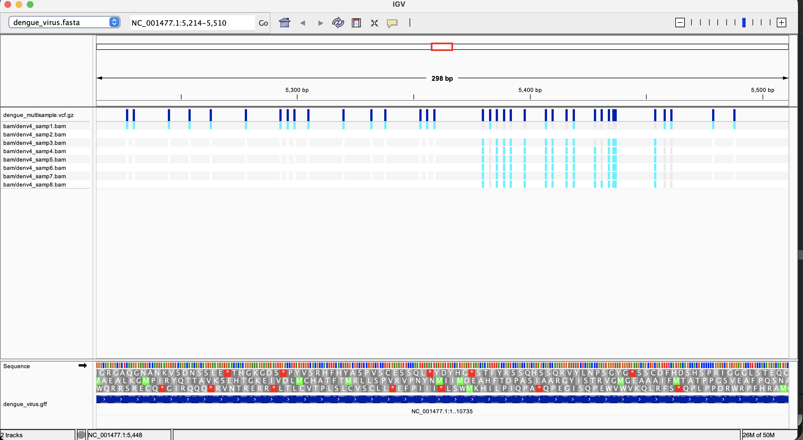

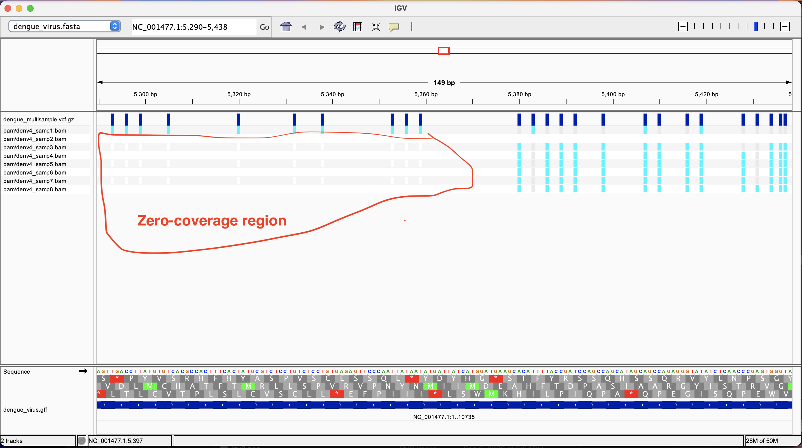

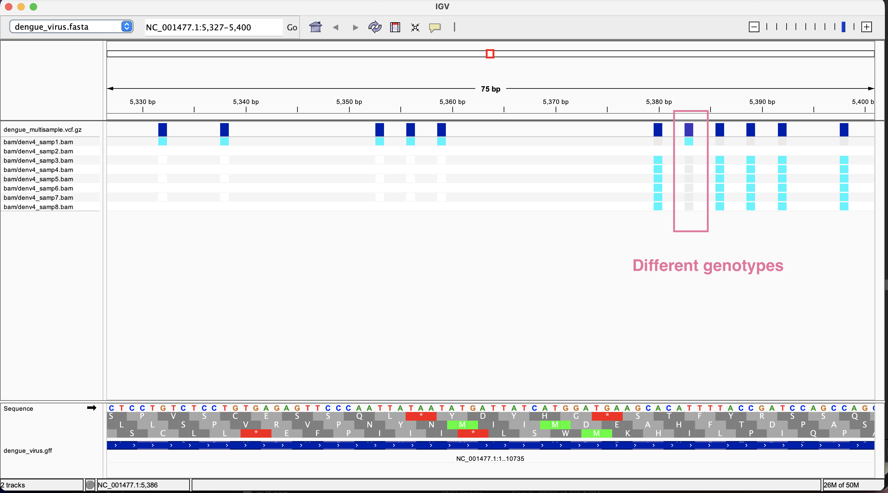


## Variant 1

Reference: A
alternate: C
Original: ACA = Threonine(T)

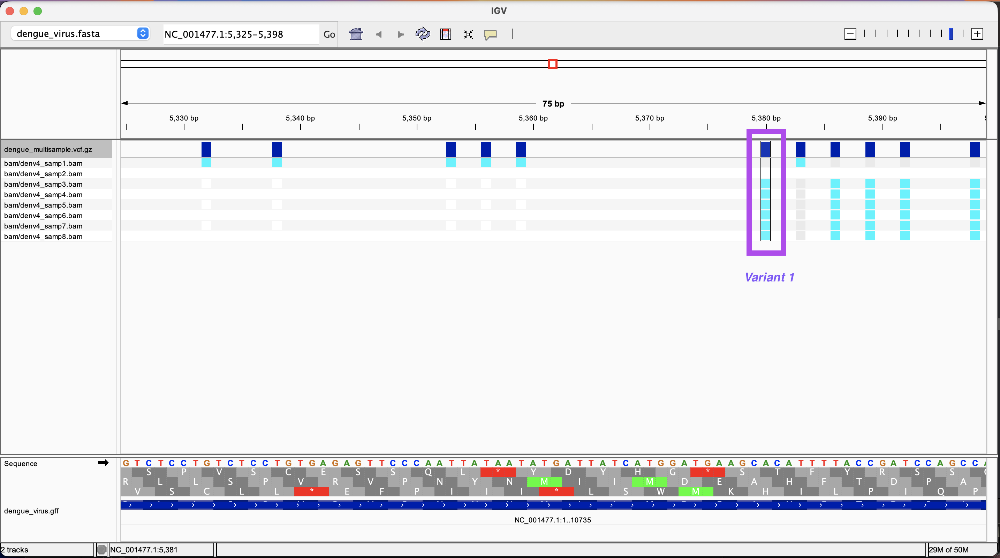

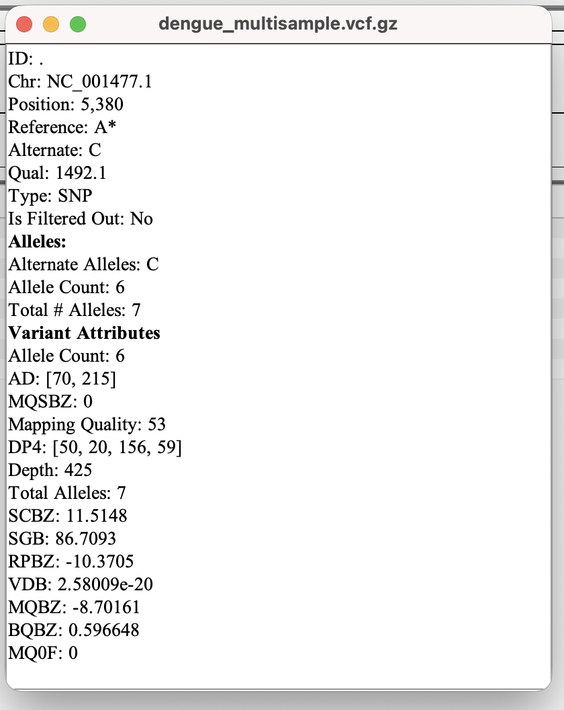


- **Sample 1**

Reference: A
Variant: A

**No change in amino acid**

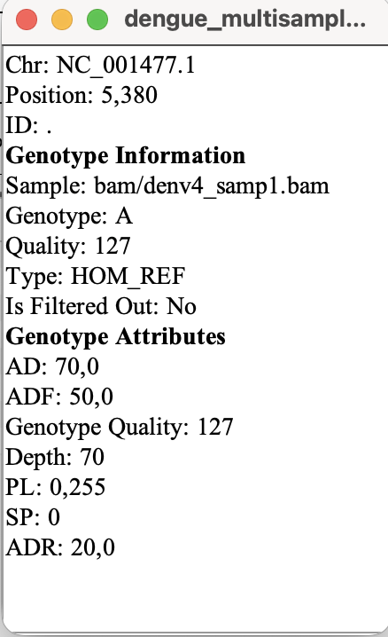


- **Sample 2**

Zero coverage across all regions. Perhaps a faulty or mismatched sample.

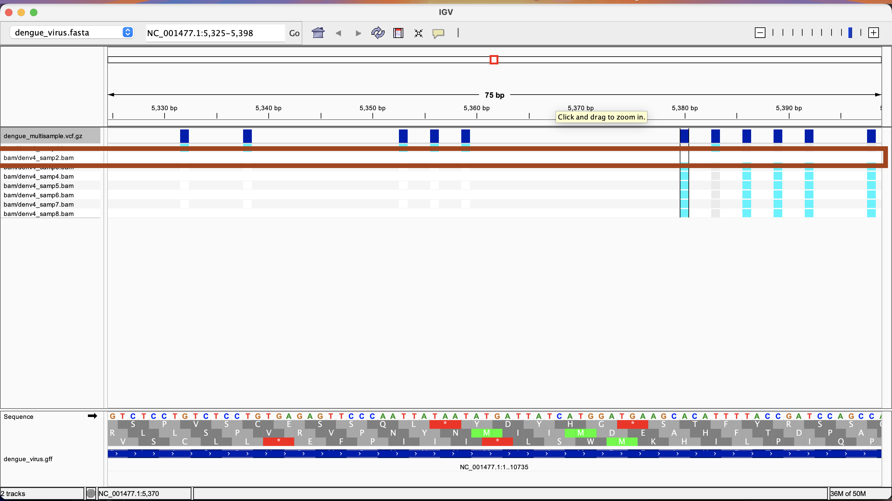


- **Sample 3**

Reference: A
Variant: C
Original: ACA = Threonine(T)
New amino acid: CCA = Proline (P) = **nonsynonymous variation**


- **Sample 4**

Reference: A
Variant: C
Original: ACA = Threonine(T)
New amino acid: CCA = Proline (P) = **nonsynonymous variation**

- **Sample 5**

Reference: A
Variant: C
Original: ACA = Threonine(T)
New amino acid: CCA = Proline (P) = **nonsynonymous variation**

- **Sample 6**

Reference: A
Variant: C
Original: ACA = Threonine(T)
New amino acid: CCA = Proline (P) = **nonsynonymous variation**

- **Sample 7**

Reference: A
Variant: C
Original: ACA = Threonine(T)
New amino acid: CCA = Proline (P) = **nonsynonymous variation**

- **Sample 8**

Reference: A
Variant: C
Original: ACA = Threonine(T)
New amino acid: CCA = Proline (P) = **nonsynonymous variation**


## Variant 2

Reference: T
alternate: C
Original: TTT = Phenylalanine(F)

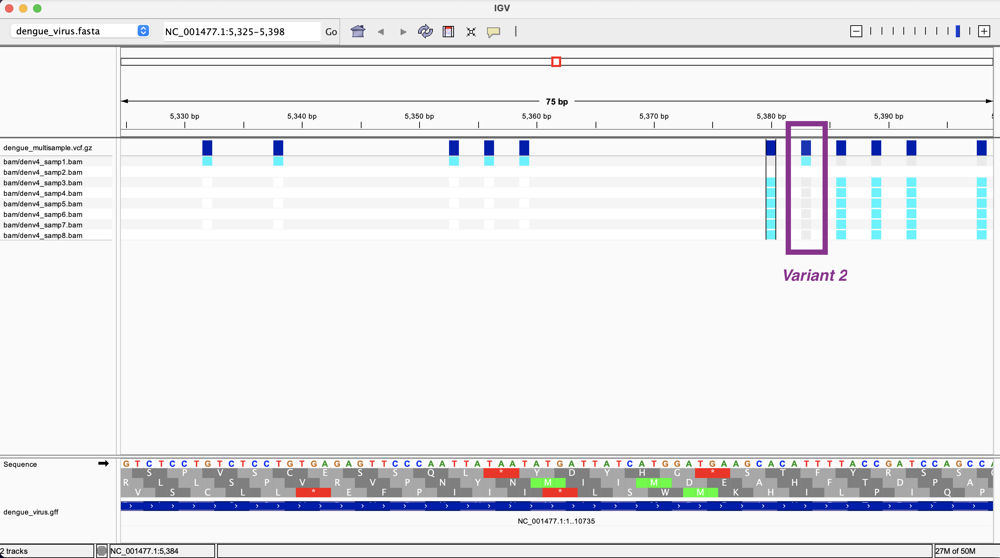

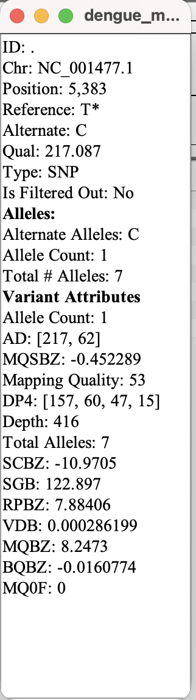


- **Sample 1**

Reference: T
Variant: C
Original: TTT = Phenylalanine(F)
New amino acid: CTT = Leucine (L) = **nonsynonymous variation**


- **Sample 2**

Zero coverage across all regions. Perhaps a faulty or mismatched sample.


- **Sample 3**

Reference: T
Variant: C

**No change in amino acid**

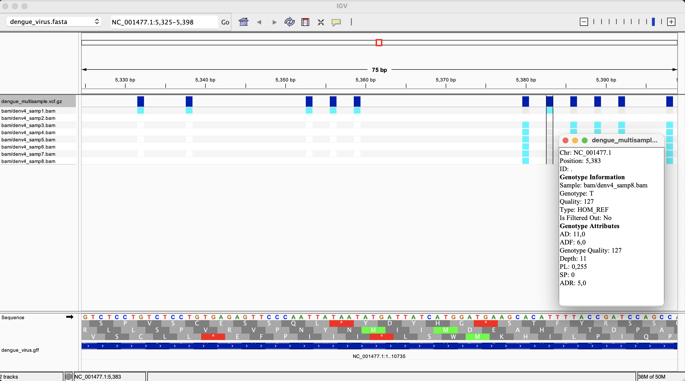


- **Sample 4**

Reference: T
Variant: C

**No change in amino acid**

- **Sample 5**

Reference: T
Variant: C

**No change in amino acid**

- **Sample 6**

Reference: A
Reference: T
Variant: C

**No change in amino acid**

- **Sample 7**

Reference: T
Variant: C

**No change in amino acid**

- **Sample 8**

Reference: T
Variant: C

**No change in amino acid**


## Using snpEff software

```
pixi add snpeff bio
# Dump the databases to a file.
snpEff databases > database.txt
cat database.txt | grep dengue
```

**There is no dengue entry. Thus we need to build a custom database. I do this below using Gemini assistance**

```
mkdir -p data/dengue

# Confirm the directory exists
Run ls -d data/dengue 


# Copy existing FASTA and GFF files into the new directory. 
cp fasta/dengue_virus.fasta data/dengue/sequences.fa
cp gff/dengue_virus.gff data/dengue/genes.gff

#Verification: 
ls data/dengue/ 

#Create a snpEff.config file in main project directory to register the Dengue genome.
printf "data.dir = ./data\ndengue.genome : Dengue Virus\n" > snpEff.config

#Verification: 
cat snpEff.config 

#Run the build command, telling SnpEff to use your local config file (-c) and the GFF3 format (-gff3). The terminal will output a processing log. At the bottom, it should say Done. and you will see a new snpEffectPredictor.bin file inside your data/dengue/ folder.

snpEff build -c snpEff.config -gff3 -v dengue

#annotate variant file using the local config.
snpEff -c snpEff.config dengue vcf/denv4_samp1.vcf.gz > vcf/denv4_samp1.annotated.vcf

#Verification: to confirm the annotated file was generated and has a noticeably larger file size than the original.
ls -lh vcf/denv4_samp1.annotated.vcf 
```

Below is the software output for the variant:

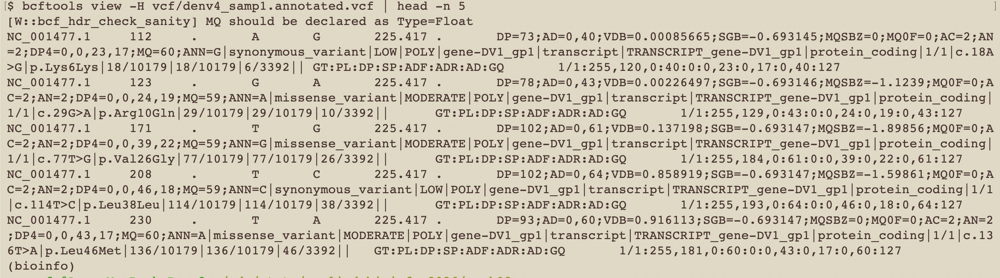
