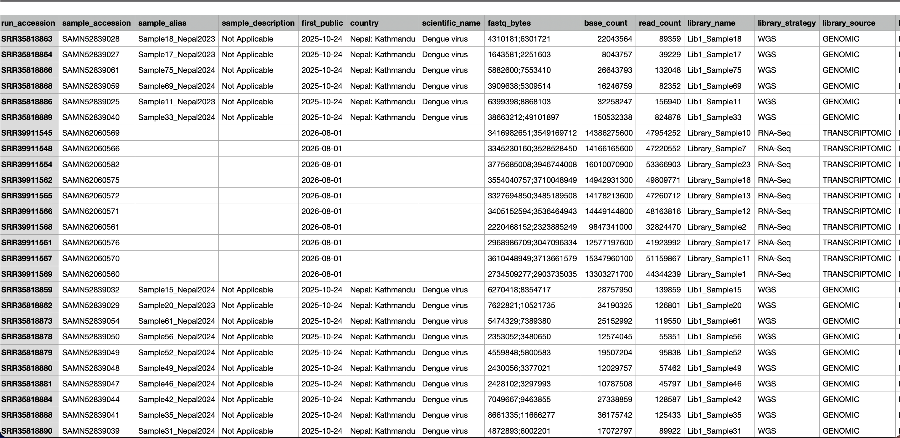
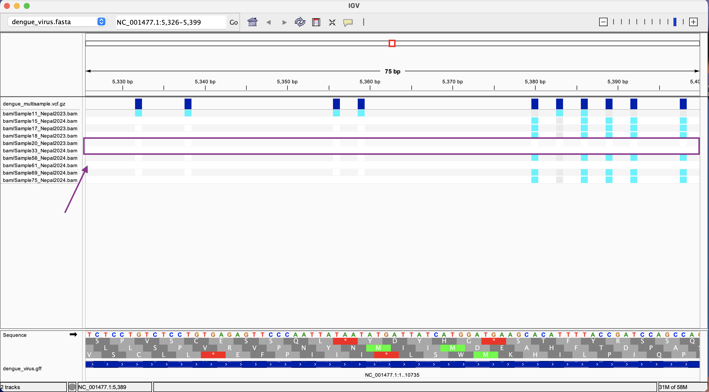
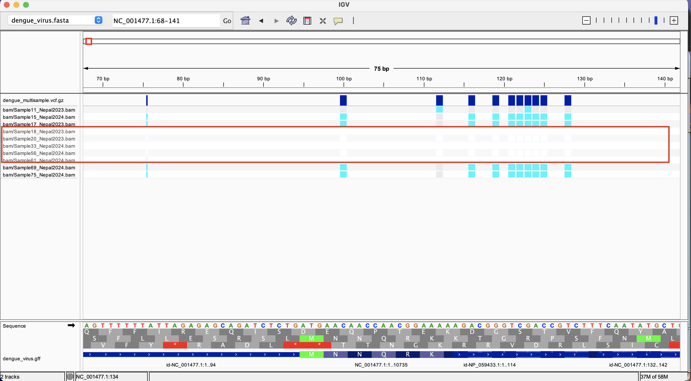
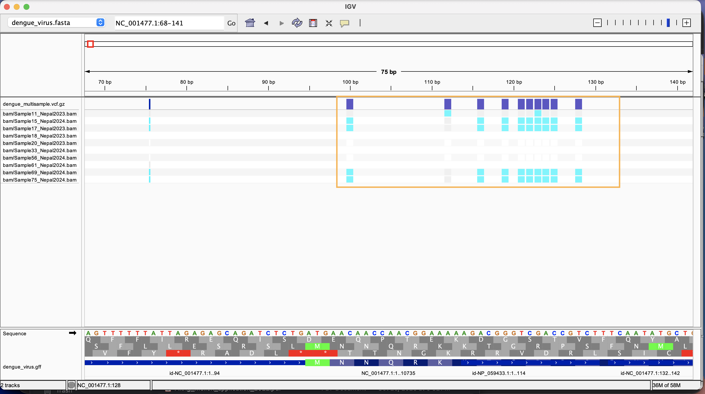
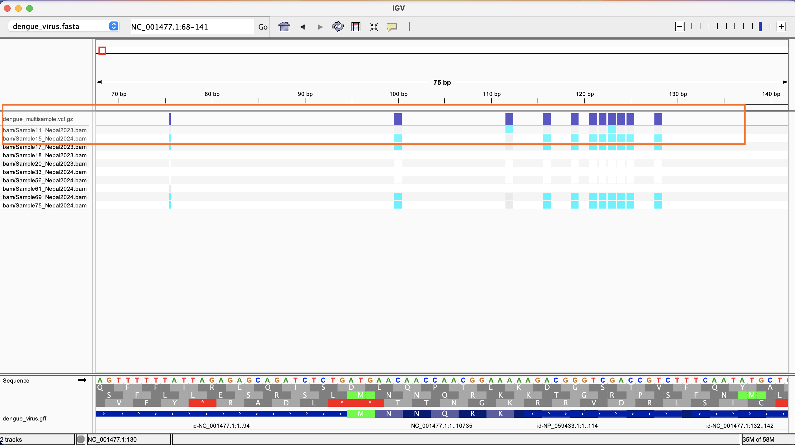

# Week 9: Create an automated workflow

This week uses the BioProject connected to the sample already last week. Keep the read count at ***20, 000*** so it's small enough that ten samples can finish on the computer, but the coverage should be realistically high enough to detect variants.


## Summary of the bioproject: how many samples, what the project was about etc.

- Bioproject - PRJNA1346681

- Reference: GCF_000862125.1

- Number of samples/ SRA experiments: 65

- Submission datae: 18-Oct-2025

- Purpose of study: Asses the influence of DENV genetic evolution on viral and epidemiuological dynamics using samples fron patients in Nepal during dengue outbreaks in 2019 and 2022. 
 
 
## Create the design file based on the BioProject

```
 # Use the `bio` shortcut to generate a design file from the SRA BioProject
bio search -H --csv PRJNA1346681 > design.csv
```

Below is a screenshot of the design file we get as output from running the above.



As you can see, we get both genomic and transcriptomic DNA. After consulting Gemini, I include the following in the batch target section of my makefile: 

```
(head -n 1 ${DESIGN}; grep -i "GENOMIC" ${DESIGN} | head -n 10) | ${PARALLEL} \
```

Below is an explanation of what the above line does:

- `head -n 1 ${DESIGN}`: grabs the very first row of your CSV (the column names) and sends it to the pipeline.

- `grep -i "GENOMIC" ${DESIGN}`: scans the entire file and extracts only the rows containing genomic library metadata, automatically dropping all interspersed transcriptomic rows.

- `head -n 10` : takes exactly the first 10 of those filtered genomic rows.

- The parentheses `(...)` : merge the header and the 10 data rows into a single clean text stream that feeds directly into parallel.


Merge all variant calls into a single VCF file.

## How to the run the workflow

After updating the makefile with the batch target, run the following:

```
make batch
```


## Visualize the results in IGV and summarize a few findings that seem relevant.

From the results in igv below, it seems samples 20, 33 and 61 have multiple regions with no variants found, perhaps due to poor quality coverage. It seems like there may have been many errors with the workflow used from sample collection, preparation, sequencing and analysis. I might need to do further investigation into these.



Navigating through more regions of the genome, we encounter more samples with regions that have similarly poor coverage. I considered sample-reference mismatch might be at play, but the paper does mention that the aim was to assess DENV1 which is the reference we used, so more investigation is certainly needed to understand what is happening.



In many cases, the samples are more similar to one another than to the reference (all have the alternate rather than the reference genome). 



Sample 11 is most dissimilar from the others and often matches the reference rather than the alternate. 


