# Evaluate gene expression coverages

Preparing files for analysis: 

- Load the chr22.genome.fa reference genome.
- Load each of the coverage files for the samples.
- Color samples by type, using the same color for replicates.
- Load the gtf/chr22.gtf GTF file.

## Look at a wide region (millions of bases wide). How are the two sample types different?

Based on a look at chr22:19,819,203-30,999,265, there seems to be high within-group/type similarity but very low between groups.

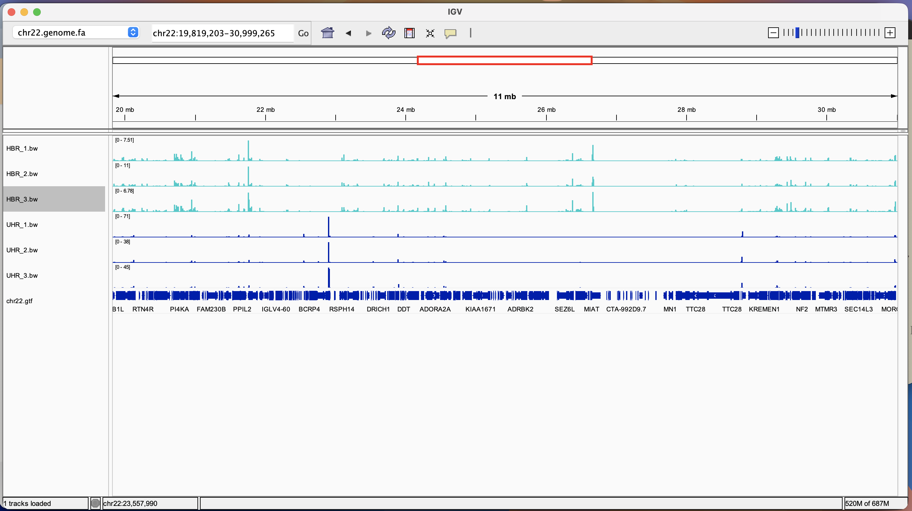

## Navigate across the genome. How consistent are the replicates?

- chr22:41,243,298-41,254,215: looks pretty consistent

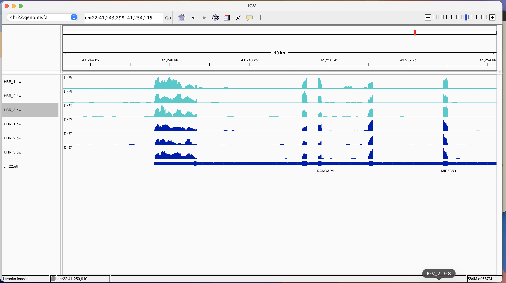

- chr22:50,029,284-50,040,201: not consistent

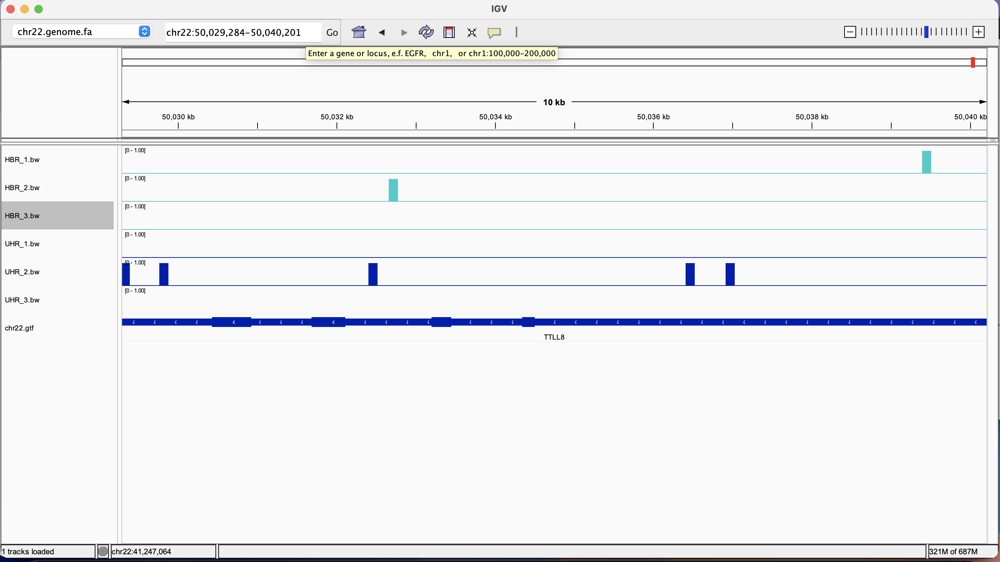

- chr22:50,441,771-50,452,688: some variation between and within groups/condition

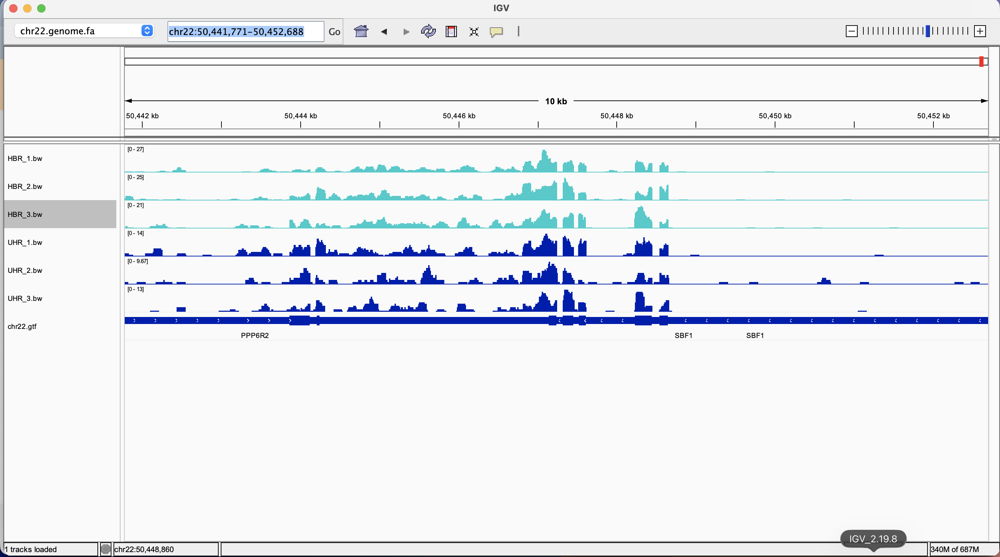

- chr22:50,689,264-50,700,181: HBR has peaks in corresponding regions but peak distribution/shape varies at matching regions; UHR replicate peaks are largely inconsistent in this region

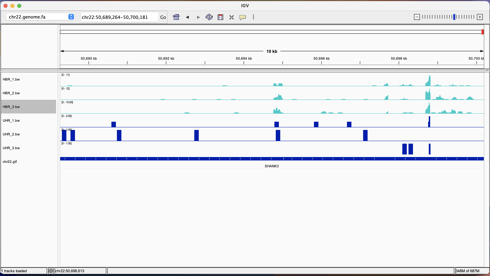

- chr22:20,618,920-20,629,837: mismatched between and across

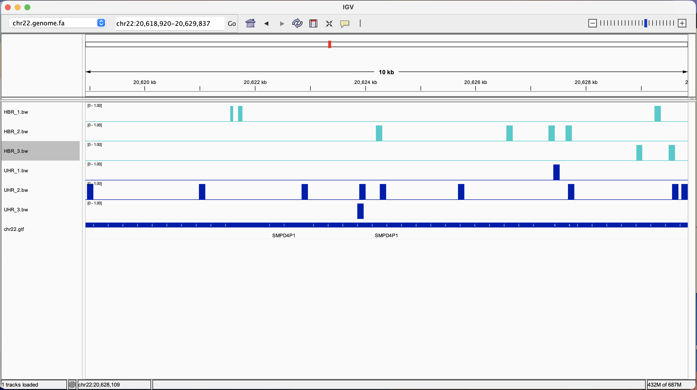

- chr22:22,310,119-22,321,036 both HBR and UHR have most of the peaks in corresponding regions but peak distribution/shape varies at matching regions

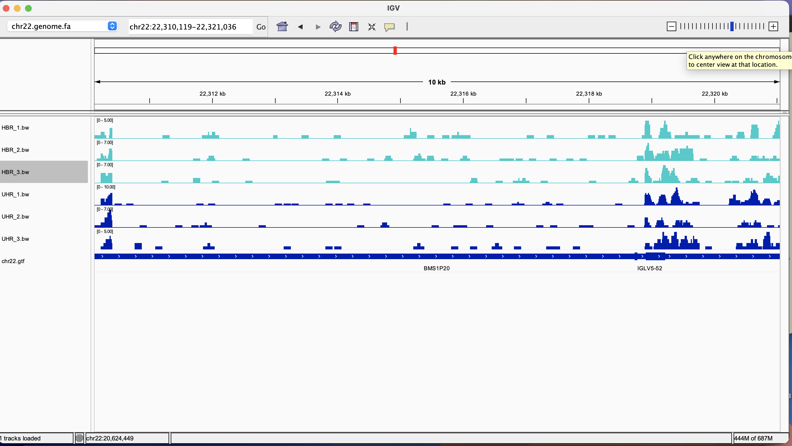

- chr22:27,136,224-27,147,141: no match

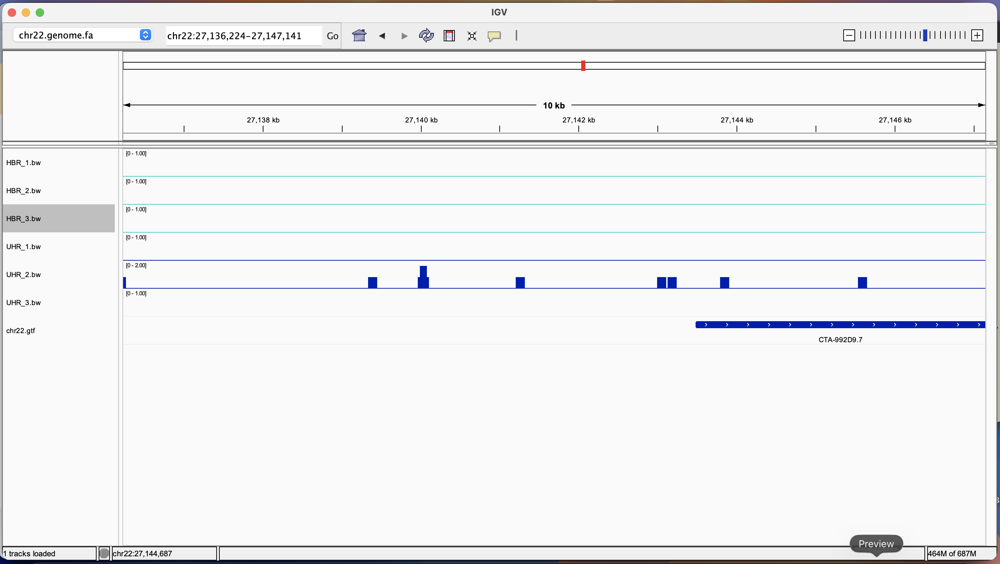

## Find a gene that is not expressed in any of the samples.

Between region chr22:10,930,921-15,303,288, there are two genes **(CU459202.1 and CU463998.1)** not expressed in any sample

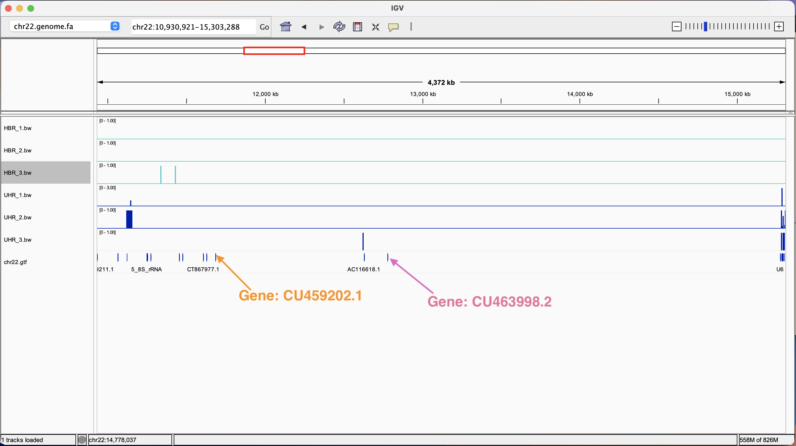

## Find a gene that is very strongly expressed in all samples. What is its coverage?

Gene_name: SNRPD3

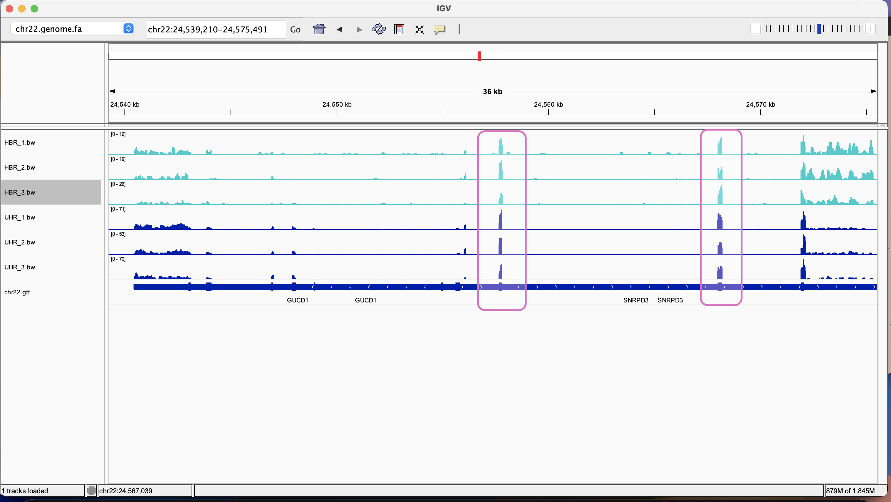

Coverage From featureCount txt files:
- HBR_1: 68
- HBR_2: 86
- HBR_3: 94
- UHR_1: 291
- UHR_2: 206
- UHR_3: 253

## Can you identify the transcripts that are expressed? Sometimes you can only exclude some candidates.

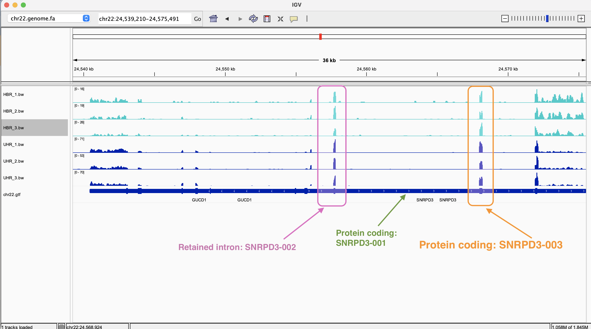

Two transcripts identified: 
- A retained intron:
    - Transcript name: SNRPD3-002; ID: ENST00000468770.1
- Two protein coding sequences, namely:
    - Transcript name: SNRPD3-001; ID: ENST00000215829.7
    - Transcript name: SNRPD3-003, ID: ENST00000402849.5

## Can you find a gene/transcript where the expression is clearly different between the two sample types? What is the fold change?

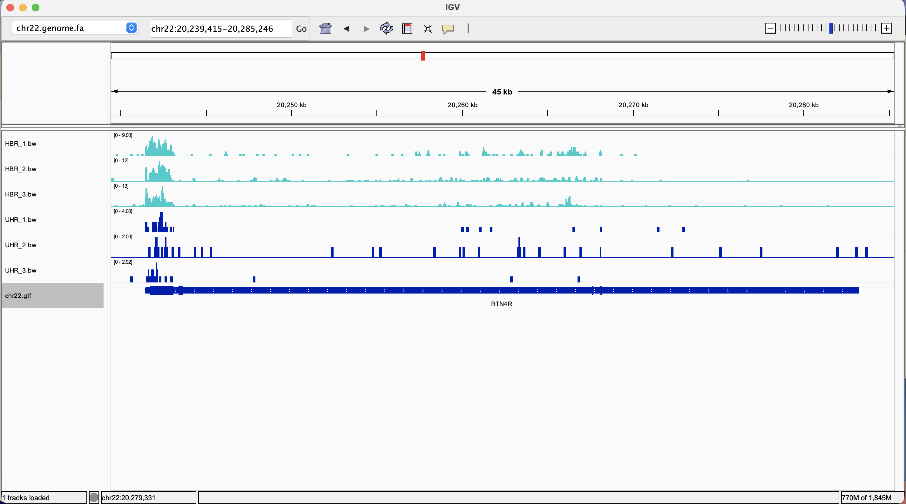

Gene name: RTN4R; ID: ENSG00000040608.13, type: protein_coding

Transcript name: RTN4R-006; ID: ENST00000469601.1; type: processed_transcript

- HBR_1: 73 vs UHR_1: 18

- HBR_2: 92 vs UHR_2: 10

- HBR_3: 83 vs UHR_3: 11

## Is the transcript upregulated or downregulated?

The transcript is downregulated in UHR compared to HBR.

## How certain are you that it is not a random fluctuation? Why?

BAM counts are consistent/similar within groups for this gene/transcript which informs my reasoning that it is unlikely to be a random fluctuation.
